<div align="center">

# CINERA

**Um catálogo de filmes curado por algoritmo, montado todo dia por um robô e servido da borda, sem servidor.**

[](https://cinera.party)

[](https://github.com/chrystianomoura/cinera/actions/workflows/ci.yml)
[](https://github.com/chrystianomoura/cinera/actions/workflows/atualizar-catalogo.yml)


[](LICENSE)

<br />

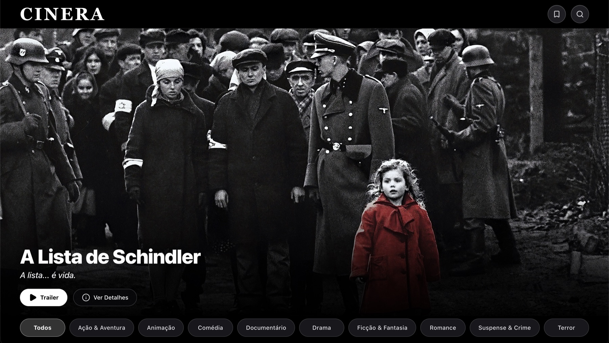&nbsp;&nbsp;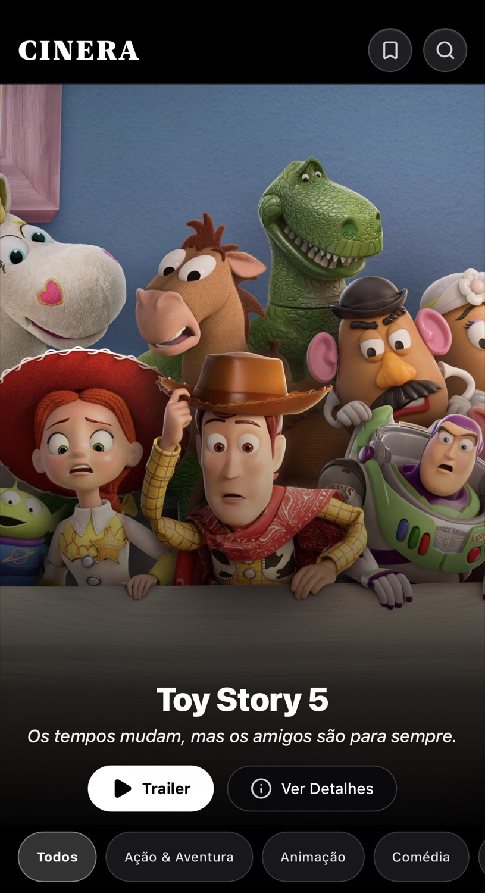

</div>

<br />

## O que é

O CINERA organiza filmes em **9 categorias** e **5 fileiras** (Em Alta, Novidades, Aclamados, Clássicos e Populares), com um destaque em tela cheia, ficha completa de cada filme e a lista de onde assistir **no Brasil**.

A graça não está só na tela, está no que acontece por trás dela: **ninguém escolhe os filmes na mão**. Um robô cruza notas de públicos e fontes diferentes, descarta nota inflada, espalha as franquias, gira a ordem de um jeito determinístico e publica o resultado todo dia, **só se passar numa bateria de validações**. O site em si é feito só de arquivos estáticos na borda do Cloudflare, e um Worker minúsculo guarda as chaves de API.

> Mais de 2.500 filmes distintos, até 400 por categoria, atualizados todos os dias, sem banco de dados e sem servidor para manter.

## Em destaque

- **Curadoria algorítmica explicável.** Cada posição da lista tem uma razão, e os critérios estão no código ([`scripts/curation/`](scripts/curation)), cobertos por testes.
- **Zero servidor, zero banco.** O catálogo é JSON versionado no Git. O histórico do que mudou a cada dia é o próprio `git log`.
- **Segurança sem chave no navegador.** O site nunca fala com o TMDB nem com o OMDb: passa por um Worker com rotas fixas, cache e limite de requisições.
- **Qualidade medida, não prometida.** Tipos, lint, 172 testes unitários, 82 cenários ponta a ponta (desktop e mobile), acessibilidade com axe e validação do catálogo publicado, tudo no CI.
- **Classificação única.** Ficha, pesquisa e listas usam a mesma função para decidir a categoria de um filme, então o mesmo filme nunca aparece em categorias diferentes dependendo da tela.

## Tour

<div align="center">

**Fileiras da Home** · rolagem horizontal, uma curadoria por fileira

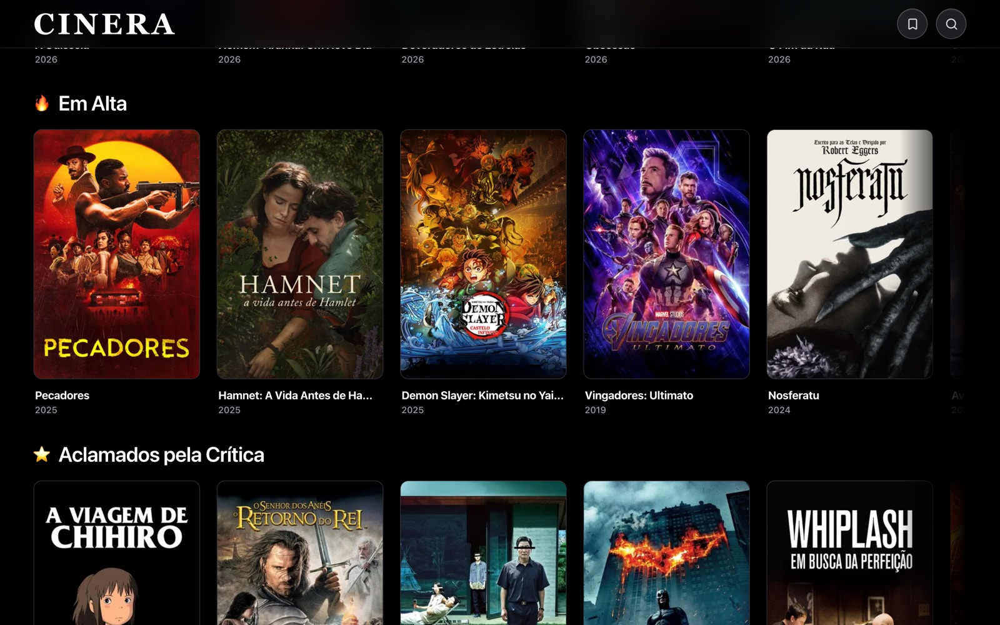

<br /><br />

| **Ficha do filme** · onde assistir, notas e ações | **Categoria** · grade com rolagem infinita |
|:---:|:---:|
| 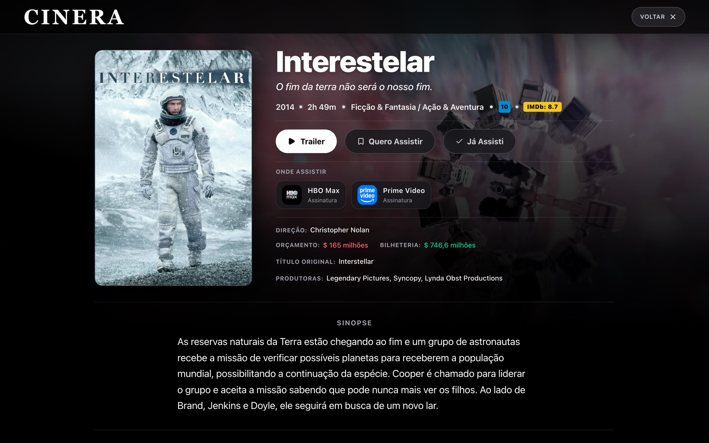 | 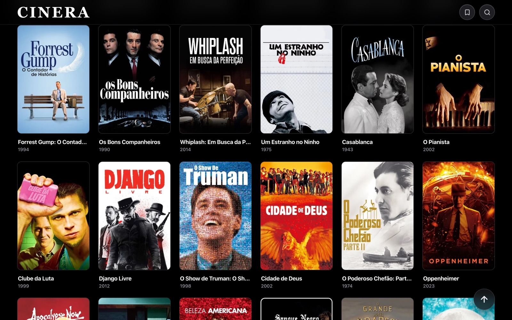 |

**Pesquisa** · teclado primeiro, com as categorias do CINERA em cada resultado

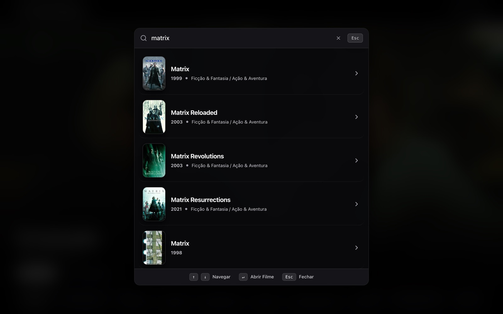

<br /><br />

**No celular**

| Ficha | Categoria | Pesquisa |
|:---:|:---:|:---:|
| 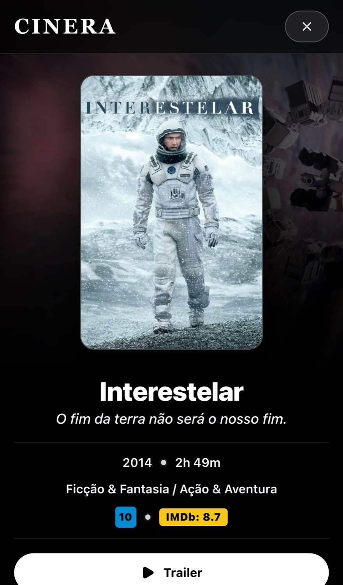 | 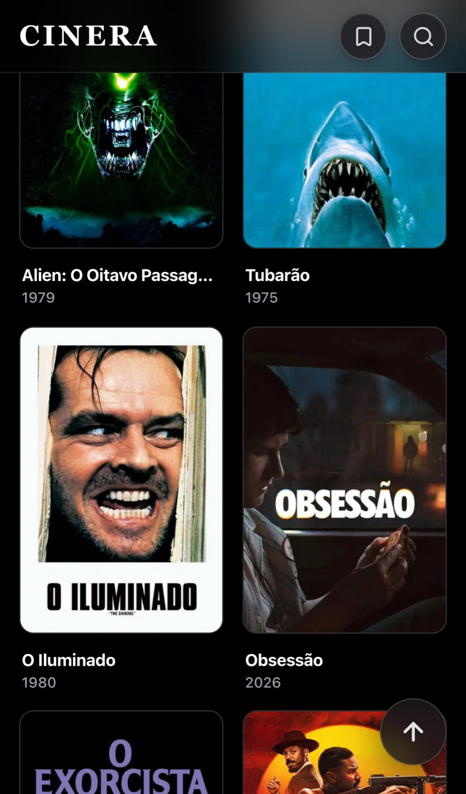 | 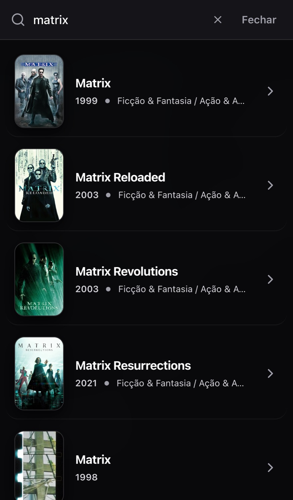 |

</div>

## O projeto em números

| | |
|---|---|
| **Catálogo** | Mais de 2.500 filmes distintos · 9 categorias de até 400 filmes · 5 fileiras · 5 destaques |
| **Peso do site** | 147 KB de JavaScript e 12 KB de CSS (gzip) · catálogo da Home em 58 KB (gzip) · foto do destaque em AVIF, de 160 a 340 KB |
| **Código** | ~13 mil linhas de TypeScript (app, Worker, scripts e testes) · 200+ commits |
| **Testes** | 172 unitários · 82 cenários ponta a ponta (41 × desktop e mobile, 67 executados) · validação do catálogo publicado |
| **Lighthouse** | Acessibilidade **100** · Boas práticas **100** · SEO **100** · Desempenho ~90 (desktop) e ~83 (mobile) |
| **Automação** | 4 rodadas do robô por dia · CI em cada push · Dependabot semanal |

## Funcionalidades

| | |
|---|---|
| **Home** | Destaque em tela cheia (5 filmes, 7 s cada, com efeito Ken Burns), filtros por categoria e fileiras com rolagem horizontal |
| **Categorias** | Listas de até 400 filmes com rolagem infinita; o fim da lista sempre fecha uma linha cheia, em qualquer largura de tela |
| **Ficha do filme** | Sinopse, elenco, galeria, trailer, classificação indicativa, notas e **onde assistir no Brasil** (assinatura ou, quando não há, aluguel) |
| **Pesquisa** | Tolerante a acento e a variações de título, entende coleções e franquias, e sempre devolve só as categorias do CINERA |
| **Minha biblioteca** | "Quero assistir" e "Já assisti", guardados no próprio navegador, sem cadastro |
| **Acessibilidade** | Navegação por teclado, foco gerenciado nos modais, rótulos ARIA e auditoria automática com axe |

## Como funciona

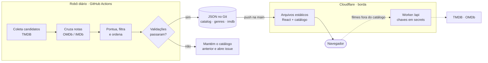

**O caminho comum nunca toca em API externa.** Home, categorias e a nota do IMDb dos filmes do catálogo saem de arquivos estáticos servidos pela CDN. O Worker só entra para o que não está no catálogo (por exemplo, a ficha de um filme encontrado na pesquisa), com cache de 1 hora para o TMDB e de 24 horas para o OMDb.

### O que acontece ao abrir uma ficha

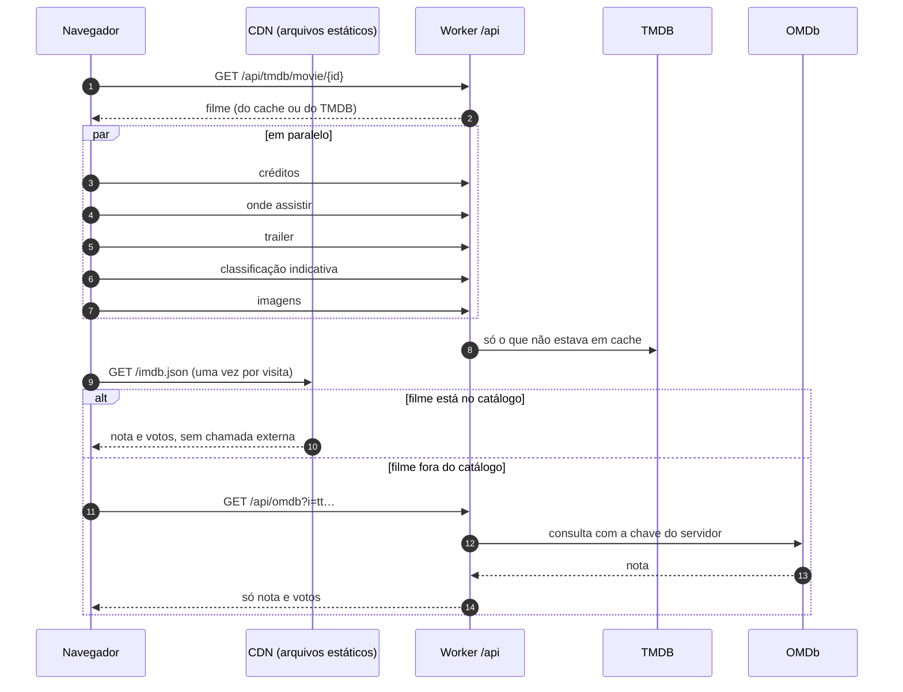

### Um dia na vida do catálogo

| Hora (Brasília) | O que acontece |
|---|---|
| **00h30** | O robô monta o catálogo do dia: coleta, pontua, ordena, gira a ordem e valida. Se tudo passar, faz o commit na `main`, e o Cloudflare publica em poucos minutos, já com as fotos do destaque recodificadas em AVIF pelo build |
| **06h30 · 12h30 · 18h30** | Rodadas de reserva: se o catálogo de hoje já está publicado, encerram em segundos sem gastar cota; se a da madrugada falhou, tentam de novo |
| **Se tudo falhar** | O catálogo do dia anterior continua no ar e o robô abre uma issue no repositório |

### A curadoria

<details>
<summary><b>Como um filme entra, e em que posição</b></summary>

<br />

1. **Candidatos.** O robô junta os mais votados e os mais bem avaliados de cada gênero (até 150 páginas por categoria).
2. **Filtros de qualidade.** Fica fora o filme sem nota do IMDb, com poucos votos, com **nota inflada** (TMDB e IMDb divergindo mais de 1 ponto) ou com consenso baixo.
3. **Nota de consenso.** 60% IMDb + 40% TMDB com média bayesiana (para um filme de 12 votos não valer o mesmo que um de 12 mil), mais um ajuste limitado pela crítica (Metacritic e Rotten Tomatoes, quando existem). Quem não tem nota de crítica não é prejudicado.
4. **Pontuação da categoria.** Consenso + bônus de prestígio (Oscar e premiações) + bônus por ter a categoria como **primeira** etiqueta + popularidade em escala logarítmica.
5. **Franquias espalhadas.** Os primeiros 15 filmes de uma lista são de franquias diferentes, e depois delas o mesmo universo só reaparece com pelo menos 10 posições de distância.
6. **Duas camadas.** Um **topo de 200** com o piso de público cheio e uma **cauda de até 200** com piso menor, sempre abaixo do topo.
7. **Rotação diária determinística.** A ordem gira em blocos, sem arquivo de estado: o resultado depende só da data, então é reproduzível e uma falha num dia não corrompe o seguinte. A única memória é o destaque (abaixo). A curva de qualidade se mantém, e a posição 12 nunca vira um filme muito pior que a 11. Os 10 primeiros de **todas** as fileiras trocam de lugar todo dia, em blocos do mesmo nível, e os **5 filmes do destaque mudam todo dia**, um de cada fileira. Um filme que foi destaque só volta depois de **7 dias**: o `catalog.json` guarda os ids dos últimos destaques em `heroHistory` (ignorado pelo site), e o robô e a validação usam esse histórico.

Cada regra tem teste. O `npm run test:catalog` confere o catálogo **publicado**, não só o código.

</details>

### O robô

O workflow [`atualizar-catalogo.yml`](.github/workflows/atualizar-catalogo.yml) só publica depois de passar por **todas** as validações: tamanho mínimo das listas, ausência de repetição, formato dos dados, cobertura das notas do IMDb e mudanças bruscas em relação a ontem. Se qualquer passo falhar, o catálogo anterior é restaurado e nada é commitado.

## Dados e contratos

Tudo que o site lê é um arquivo estático, validado com **Zod** na hora de carregar. Se um arquivo vier inválido, o app descarta e cai na busca ao vivo, em vez de quebrar.

| Arquivo | Conteúdo | Tamanho (gzip) |
|---|---|---|
| `public/catalog.json` | Destaque, histórico dos últimos destaques (`heroHistory`) e as 5 fileiras da Home | 58 KB |
| `public/genres/<categoria>.json` | A lista de cada categoria, já na ordem de exibição | 55 a 115 KB cada |
| `public/categories.json` | Índice id → categorias de todos os filmes (pesquisa e ficha usam o mesmo resultado das listas) | 11 KB |
| `public/imdb.json` | IMDb ID → nota e votos dos filmes do catálogo | 20 KB |

## Front-end

```text
domain/          regras puras e sem dependência de interface (classificação de categorias, tipos)
infrastructure/  tudo que fala com o mundo: Worker, arquivos do catálogo, pesquisa, schemas Zod
features/        cada tela é uma pasta (catálogo, ficha, pesquisa, biblioteca, destaque, trailer)
hooks/ stores/   dados da tela (TanStack Query) e a biblioteca do usuário (Zustand)
lib/             utilitários de interface (rolagem, viewport estável, formatação, decodificação de imagem)
```

- **Dados do servidor** com TanStack Query: cache e deduplicação de chamadas.
- **Biblioteca do usuário** com Zustand, persistida no navegador, sem backend.
- **Reserva em camadas.** Catálogo estático, depois busca ao vivo pelo Worker. Se a API cair, a Home continua de pé e a pesquisa e a ficha mostram o erro (com botão de tentar de novo), em vez de preencher com dados falsos.
- **Modo demonstração isolado.** Os filmes de exemplo ficam num pacote separado (`VITE_DEMO_MODE=true`) e nunca fazem parte do caminho de produção.

## Desempenho

| Recurso | Cache |
|---|---|
| `/` e `index.html` | `no-cache`, para um novo deploy chegar na hora |
| `/assets/*` (nome com hash) | 1 ano, `immutable` |
| `/hero/*` (fotos do destaque em AVIF, hash no nome) | 1 ano, `immutable` |
| Catálogo, listas e índices | 5 minutos, com revalidação |
| Logos e ícones | 7 dias |

**Medição (Lighthouse, site no ar, em 03/10/2026, mediana de 3 rodadas; anterior às mudanças na foto do destaque descritas abaixo):**

| | Acessibilidade | Boas práticas | SEO | Desempenho | LCP | TBT | CLS |
|---|:---:|:---:|:---:|:---:|:---:|:---:|:---:|
| **Desktop** | 100 | 100 | 100 | 90 (89 a 96) | 1,9 s | 0 ms | 0 |
| **Mobile** | 100 | 100 | 100 | 83 (83 a 85) | 4,2 s | 0 ms | 0 |

Uma otimização medida: o destaque do desktop baixava a imagem original (981 KB, 3834 px) para um espaço de 1351 px. Com o `srcset` corrigido, telas normais passaram a carregar a de 1280 px. O resultado foi **−878 KiB de peso, LCP de 2,5 s para 1,9 s e nota de 85 para ~90 no desktop**. Só as telas de alta densidade (retina) ainda recebiam a original, e a segunda rodada abaixo revisitou isso.

São números de laboratório com rede e CPU simuladas, e variam de uma rodada para outra.

### A foto do destaque, segunda rodada (15/10/2026)

Três etapas. A do meio foi um erro, e fica registrada de propósito:

1. **A foto só começava a baixar tarde.** O `` do destaque só existe depois do JavaScript (496 KB sem comprimir), do React e do `catalog.json`. O build passou a colocar no `index.html` um `<link rel="preload">` da primeira foto, lida de `public/catalog.json`. A foto passou a ser pedida aos ~170 ms, em vez de ~1.950 ms.
2. **Tentativa que deu errado: parar no `w1280`.** Para tirar o peso da `original` (de 0,6 a 1,5 MB por foto), o `srcset` parou nos 1280 px (95 a 185 KB). Pesou menos e ficou **borrado**: medindo no Chrome quantos pixels do aparelho cobrem cada pixel da foto (acima de 1,35× fica macia, acima de 1,8× borrada), a `w1280` era esticada de 2,2× a 2,4× no Mac retina e nos iPhones. A causa é o `sizes`: ele descrevia a largura do quadro, mas a foto é 16:9 e o `object-cover` a corta (para 4:5 no celular), então a parte visível é bem maior que o quadro e o navegador subestimava os pixels necessários. O mesmo erro já deixava o iPhone comum borrado (2,2×) antes dessa tentativa, sem que ninguém tivesse medido.
3. **A solução: AVIF de 3840 px, gerado no build.** A TMDB só entrega JPEG e não tem nada entre 1280 e 3840 px. O build ([`vite-plugin-hero-images.ts`](vite-plugin-hero-images.ts)) baixa as originais das 5 fotos do destaque, recodifica em **AVIF** (qualidade 50, de 160 a 340 KB cada, ~39 dB de fidelidade) e as publica no próprio domínio, em `/hero/<nome>.<hash>.avif`, com cache de 1 ano. Uma foto só serve todos os aparelhos, e o `index.html` precarrega a primeira. O app descobre quais existem por um módulo virtual (`virtual:hero-images`). O `` fica dentro de um `<picture>`: navegador sem AVIF, ou foto sem AVIF, cai no **plano B**, o JPEG da TMDB, agora com a `original` no `srcset` e um `sizes` que descreve a foto inteira (236vw no celular, no mínimo 1432 px no desktop), então o plano B também fica nítido.

| Chrome, 4G lento simulado | Antes (original; no iPhone, `w1280`) | `w1280` + preload (a tentativa) | AVIF + preload (atual) |
|---|:---:|:---:|:---:|
| **Mac retina** · foto pronta na tela | 7,6 s | 2,6 s | 2,8 s |
| **Mac retina** · pixels do aparelho por pixel da foto, no fim do zoom | 0,8× (nítida) | 2,4× (borrada) | 0,8× (nítida) |
| **iPhone 15** · foto pronta na tela | 3,1 s | 2,6 s | 2,8 s |
| **iPhone 15** · pixels do aparelho por pixel da foto, no fim do zoom | 2,2× (borrada) | 2,2× (borrada) | 0,7× (nítida) |

Como foi medido: Chrome com rede de 4G lento simulado (1,6 Mbps e 150 ms), servidor local que comprime como o Cloudflare, os mesmos arquivos da TMDB servidos localmente, 3 rodadas por caso (variação abaixo de 30 ms), até a foto estar carregada na tela. Só no Chrome; nada foi medido em celular de verdade, e o custo de decodificar o AVIF de 3840 px num celular ficou sem medir (neste Mac: 77 ms, contra 16 ms da `w1280`). O tempo de ~2,6 a 2,8 s é dominado pela chegada do JavaScript e do catálogo, já que o `` só existe depois deles: por isso a foto de 260 KB custa só ~0,2 s a mais que a de 140 KB. A nota do Lighthouse da tabela acima é anterior a tudo isso e ainda não foi medida de novo.

Limites: o preload cobre só a **primeira** foto. As outras quatro, a cada 7 s, carregam na hora da troca; pré-carregar todas de uma vez deixou a primeira de 2,5× a 3,6× mais lenta num teste com a rede da TMDB (2 a 3 rodadas), porque as fotos dividem a mesma rede. E, como o `catalog.json` fica 5 minutos no cache do navegador e o `index.html` não fica, quem ainda tem o catálogo do dia anterior pode, por alguns minutos depois de um deploy, baixar uma foto precarregada que não é a exibida (desperdício de banda, não quebra nada).

## Segurança

O site é público, então a pergunta é sempre "o que um visitante mal-intencionado consegue fazer?".

| Camada | Medida |
|---|---|
| **Chaves** | Nenhuma vai para o navegador. TMDB e OMDb ficam como *secrets* do Cloudflare e do GitHub; o bundle compilado é verificado para não conter nenhuma |
| **Worker `/api`** | Lista fixa de rotas aceitas (qualquer outra recebe 404), só `GET`, consultas com tamanho limitado, recusa pedidos vindos de outros sites (`Sec-Fetch-Site`) e, no OMDb, devolve só a nota e os votos |
| **Limite de requisições** | Regra no Cloudflare: 60 chamadas a `/api/` por IP a cada 10 s. Testada com 150 chamadas em rajada: 80 foram bloqueadas |
| **CSP restrita** | `default-src 'self'`; chamadas de rede só para o próprio domínio e para a métrica de visitas do Cloudflare; imagens só do TMDB e trailers só do YouTube sem cookies; sem `eval` (o Zod roda em modo `jitless` justamente por isso) |
| **Cabeçalhos** | HSTS, `nosniff`, `Referrer-Policy`, `Permissions-Policy` e `frame-ancestors 'none'` |
| **Cadeia de suprimentos** | Dependabot (versões e correções de segurança), alertas de vulnerabilidade, *secret scanning* com *push protection* e `npm audit` limpo |

A política de reporte de falhas está em [`SECURITY.md`](SECURITY.md).

## Qualidade

```text
Vitest        172 testes   regras de curadoria, classificação, Worker, serviços, mapeadores e o plugin das fotos do destaque
Playwright     82 cenários (41 × desktop e mobile; 67 executados, o resto é só de uma plataforma), com a API simulada
axe-core      auditoria de acessibilidade das telas principais
test:catalog  validação do catálogo publicado (listas, índice, notas do IMDb)
CI            lint, testes, catálogo, tipos e build, e os testes e2e em paralelo, a cada push
```

Os testes ponta a ponta **não dependem de rede externa**: o Worker e o TMDB são simulados, então não ficam intermitentes por causa de um serviço de terceiros.

Alguns conferem o que o build **realmente publica**: que o `index.html` precarrega o AVIF da primeira foto do destaque, que o arquivo é servido e que o `` usa exatamente esse mesmo arquivo ([`e2e/preload-destaque.spec.ts`](e2e/preload-destaque.spec.ts)). Foi provado por mutação: com a geração do AVIF desligada (`CINERA_HERO_AVIF=off`), eles falham. Como o build baixa as originais da TMDB, esses testes precisam de rede na primeira vez; perder o AVIF deixa a foto bem mais pesada, e isso não pode passar em silêncio.

## Decisões de engenharia

<details>
<summary><b>Por que o catálogo é um arquivo, e não uma consulta?</b></summary>

<br />

Porque a lista do dia é a mesma para todo mundo. Calcular uma vez por dia e servir da CDN é mais rápido, mais barato, não tem pico de tráfego que derrube nada e deixa a curadoria **auditável**: cada mudança é um commit com diff. A busca ao vivo existe só como reserva.

</details>

<details>
<summary><b>Por que um Worker, se o site é estático?</b></summary>

<br />

Para a chave nunca estar no JavaScript. Antes, as chaves iam no bundle (o que é inevitável em um app puro de navegador). O Worker troca isso por um intermediário com rotas fixas, cache e limite de uso, no mesmo deploy do site.

</details>

<details>
<summary><b>Por que publicar as notas do IMDb junto com o catálogo?</b></summary>

<br />

O robô já busca essas notas para a curadoria e as descartava. Publicá-las num arquivo de ~20 KB (gzip) faz a ficha dos filmes do catálogo abrir sem nenhuma chamada externa: mais rápida, funciona mesmo se a API cair e não gasta cota por visitante. A consulta ao vivo ficou só para a cauda longa.

</details>

<details>
<summary><b>Por que uma classificação única?</b></summary>

<br />

Antes, a ficha, a pesquisa e as listas decidiam a categoria de formas ligeiramente diferentes, e o mesmo filme podia aparecer em categorias distintas. Hoje existe uma função ([`classification.ts`](src/domain/classification.ts)) usada por todos, com fixtures de regressão para os casos difíceis.

</details>

<details>
<summary><b>Por que o Zod roda em modo <code>jitless</code>?</b></summary>

<br />

Por padrão, o Zod gera código com `new Function` para validar mais rápido, e isso exige `unsafe-eval` na política de segurança. Em vez de afrouxar a CSP, o app liga o modo `jitless` (em [`zod-config.ts`](src/infrastructure/zod-config.ts)), que troca um pouco de velocidade por uma política sem `eval`. Como os arquivos validados são pequenos, a diferença não aparece.

</details>

<details>
<summary><b>Por que o fim da lista "poda" filmes?</b></summary>

<br />

Para a última linha da grade fechar cheia em qualquer largura (2, 3, 4, 5 ou 6 colunas). A grade lê o número de colunas do próprio CSS e esconde no máximo `colunas − 1` filmes, só quando não há mais o que carregar. É um detalhe pequeno que muda a sensação de acabamento.

</details>

<details>
<summary><b>Por que o robô tem rodadas de reserva?</b></summary>

<br />

Porque "nunca ficar desatualizado" é um requisito, e um único horário diário é um ponto único de falha. As rodadas extras conferem a data do `catalog.json` antes de qualquer coisa e encerram em segundos se já está tudo em dia, então a redundância praticamente não custa cota.

</details>

<details>
<summary><b>Por que o preload da foto é gerado no build, e não escrito no HTML?</b></summary>

<br />

- **A foto muda todo dia.** O robô gira a ordem do destaque, então um `<link>` escrito à mão apontaria para a foto errada. O build lê o `catalog.json` do dia e escreve a tag; o catálogo e o `index.html` saem no mesmo deploy, então combinam.
- **O `` e o preload têm que pedir a mesma foto.** Com o AVIF, é o mesmo arquivo; no plano B, as duas partes usam a mesma função ([`hero-image.ts`](src/features/hero/hero-image.ts)), com teste, e o mesmo `sizes`. Se um pedisse outra foto, o navegador baixaria duas vezes, e o preload seria pior do que nada.
- **Sem preload ou sem AVIF, o build avisa em vez de falhar.** Com o catálogo ilegível, sem destaque ou uma foto que não baixa, o site só ficaria mais lento, não quebrado, então o build segue, mas escreve um aviso no registro. E o teste ponta a ponta confere o `index.html` publicado, para essa perda não passar em silêncio.

</details>

<details>
<summary><b>Por que as importações da configuração do Vite escrevem <code>.ts</code>?</b></summary>

<br />

O Vite avisava que o carregador "native" de configuração vai virar o padrão e não aceita importação sem extensão. Os arquivos que o `vite.config.ts` importa (o Worker local, o plugin das fotos do destaque e o que ele usa) agora escrevem o `.ts`, e os `tsconfig` liberam isso com `allowImportingTsExtensions` (sem efeito na saída: o projeto já usa `noEmit`). O aviso sumiu, e `vite build --configLoader native` lê a configuração normalmente.

</details>

<details>
<summary><b>Por que recodificar as fotos do destaque em AVIF, e qual é o risco?</b></summary>

<br />

- **Por quê.** A TMDB só entrega JPEG, e a única versão nítida o bastante é a `original` (3840 px, de 0,6 a 1,5 MB por foto, ~7,6 s para ficar pronta num 4G lento). A `w1280` pesa pouco, mas fica borrada. O AVIF de 3840 px com qualidade 50 pesa ~260 KB e é quase indistinguível da original (comparado lado a lado numa foto: a textura fina fica um pouco mais lisa).
- **O risco.** Os termos de uso da TMDB proíbem "fazer derivados" do conteúdo dela e não definem o termo; também não tratam de redimensionar ou recodificar. Não há confirmação de que isso seja permitido. Cada build regenera as fotos (bem abaixo do limite de 6 meses de cache dos termos) e o risco foi assumido conscientemente.
- **A saída.** `CINERA_HERO_AVIF=off` nas variáveis do build desliga a geração, e o site volta ao JPEG da TMDB (o plano B, que também é nítido, só mais pesado).

</details>

## Stack

| Área | Tecnologias |
|---|---|
| **Interface** | React 19, TypeScript, Tailwind CSS 4, Lucide |
| **Estado e dados** | TanStack Query (servidor), Zustand (biblioteca do usuário), Zod 4 (validação dos arquivos e das respostas) |
| **Build** | Vite 8, oxlint, sharp (só no build: recodifica as fotos do destaque em AVIF) |
| **Borda** | Cloudflare Workers com *static assets* e um Worker para `/api` |
| **Testes** | Vitest, Playwright, axe-core |
| **Automação** | GitHub Actions (CI e robô diário), Dependabot |
| **Dados de filmes** | TMDB (dados, pôsteres e provedores), OMDb (notas do IMDb) e YouTube, via modo sem cookies, para os trailers |

## Deploy

O deploy é automático: cada push na `main` dispara o build no Cloudflare (`npm run build`) e publica com `npx wrangler deploy`. O [`wrangler.jsonc`](wrangler.jsonc) declara a pasta `dist` como arquivos estáticos (com fallback de SPA) e o Worker de [`worker/`](worker), que roda apenas para `/api/*`.

Para publicar o seu, crie os secrets `TMDB_TOKEN` e `OMDB_KEY` no Worker e, no GitHub, os secrets `TMDB_TOKEN` e `OMDB_SCRIPT_KEY` do robô. A variável `CATALOGO_AUTOMATICO=true` liga as rodadas agendadas.

## Rodando localmente

Requisitos: Node 22 ou mais novo (o CI e o robô usam o 24).

```bash
git clone https://github.com/chrystianomoura/cinera.git
cd cinera
npm ci

cp .env.example .env.local   # preencha TMDB_TOKEN e OMDB_KEY
npm run dev                  # http://localhost:5173
```

O `npm run build` baixa as 5 fotos do destaque na TMDB e gera os AVIF (precisa de rede na primeira vez; depois ficam em `node_modules/.cache/cinera-hero-images`). Sem rede, ou para pular essa etapa: `CINERA_HERO_AVIF=off npm run build`.

No `npm run dev`, um plugin do Vite responde `/api/*` com o **mesmo código do Worker**, lendo as chaves do `.env.local`. Elas ficam só no servidor local.

Sem chaves, dá para ver o app com filmes de exemplo:

```bash
VITE_DEMO_MODE=true npm run dev
```

### Scripts

| Comando | O que faz |
|---|---|
| `npm run dev` | Servidor de desenvolvimento |
| `npm run build` | Checa os tipos e gera o build de produção, já com as fotos do destaque em AVIF (`dist/hero/`) e o preload no `index.html` |
| `npm run preview` | Serve o build de produção localmente |
| `npm test` | Testes unitários (Vitest) |
| `npm run test:watch` | Testes unitários em modo de observação |
| `npm run test:e2e` | Testes ponta a ponta e de acessibilidade (Playwright; ele mesmo faz o build e sobe o `preview`) |
| `npm run test:catalog` | Valida o catálogo publicado |
| `npm run test:search` | Audita a pesquisa contra resultados esperados ([`audit-search.ts`](scripts/audit-search.ts)) |
| `npm run build:catalog` | Monta o catálogo inteiro e só publica se tudo passar |
| `npm run curate:aclamados` · `classicos` · `em-alta` · `novidades` · `populares` | Relatório de uma fileira (`-- --write` grava em `public/catalog.json`) |
| `npm run curate:generos` | Relatório das 9 categorias (`-- --write` grava `public/genres/*.json`; `-- Drama --write` grava só uma) |
| `npm run curate:hero` | Escolhe só o destaque do dia (`-- --dry` mostra sem gravar) |
| `npm run lint` | Lint com oxlint |

## Estrutura

```text
src/
  domain/            tipos do domínio e a classificação única de categorias
  features/          catálogo, ficha, pesquisa, biblioteca, destaque, trailer
  infrastructure/    clientes de API, leitura do catálogo, pesquisa, schemas Zod
  hooks/ stores/     dados da tela e biblioteca do usuário
  lib/               utilitários de interface (rolagem, viewport estável, formatação, decodificação de imagem)
  dev/               medidor de FPS, só no `npm run dev` com `?fps=1` (some do build publicado)
worker/              o Worker de /api (rotas fixas, cache, limites) e seus testes
vite-plugin-hero-images.ts    plugin do build: gera as fotos do destaque em AVIF, o módulo `virtual:hero-images` e o preload no index.html (e o teste dele)
scripts/
  curation/          pontuação, filtros, rotação, validação e notas do IMDb
  build-catalog.ts   monta o catálogo e só publica se passar nas verificações
e2e/                 testes ponta a ponta e de acessibilidade
public/              o catálogo publicado, ícones, cabeçalhos e manifest
docs/screenshots/    imagens deste README
.github/workflows/   CI e robô diário
```

## Limitações e próximos passos

Nenhum projeto está pronto, e vale dizer o que falta:

- **LCP no mobile (4,2 s na última medição do Lighthouse, anterior às mudanças da foto).** A foto já é precarregada e o AVIF pesa pouco (veja Desempenho), mas a nota do Lighthouse ainda precisa ser medida de novo. Pelo que foi medido, o que segura a foto é a chegada do JavaScript e do catálogo: dividir o JavaScript (77 KB sem uso no carregamento, na medição de 03/10) é o próximo ganho, e pré-carregar a próxima foto do rodízio, em sequência e uma de cada vez, evita esperar na troca.
- **Atribuição da TMDB.** Os termos da TMDB pedem a logo dela e o aviso "uses TMDB and the TMDB APIs but is not endorsed, certified, or otherwise approved by TMDB"; o site ainda não mostra nenhum dos dois (conferido na página inicial).
- **Fotos em AVIF e os termos da TMDB.** Os termos proíbem "fazer derivados" do conteúdo da TMDB sem definir o termo e não tratam de redimensionar ou recodificar; recodificar as fotos do destaque é um risco assumido conscientemente. `CINERA_HERO_AVIF=off` no build desliga a geração e devolve o site ao JPEG da TMDB.
- **Limite de requisições curto.** No plano gratuito do Cloudflare o bloqueio dura 10 s. Um contador de uso dentro do Worker (com KV) cortaria o abuso por completo, e só vale a pena se o tráfego mostrar necessidade.
- **Notas de filmes novos.** Filmes fora do catálogo dependem da consulta ao vivo ao OMDb e, se a cota acabar, aparecem sem a nota do IMDb até o dia seguinte. Os do catálogo não são afetados.
- **Sem contas de usuário.** A biblioteca vive no navegador de cada pessoa; trocar de aparelho começa do zero.

## Licença

[MIT](LICENSE) © Chrystiano Moura
